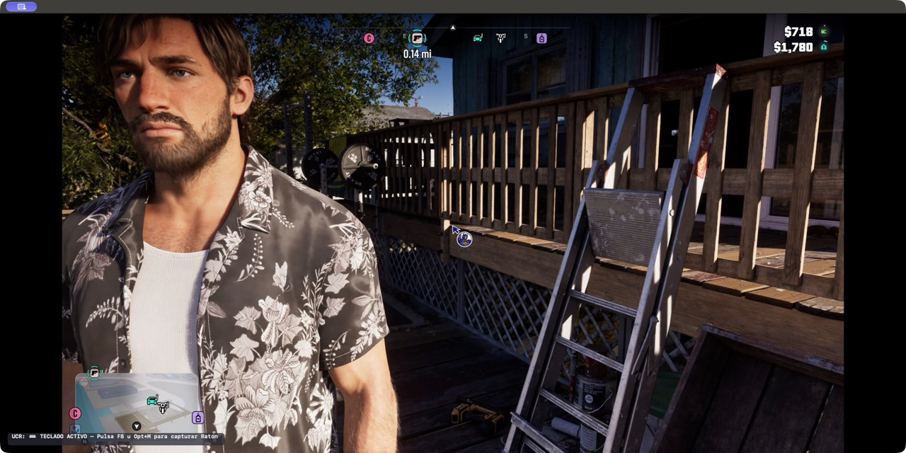

# gamepad-mcp

A scriptable gamepad for AI agents: an [MCP](https://modelcontextprotocol.io)
server that plays games by posting **real HID keyboard and mouse events** on
the host machine.

## Why this exists

Driving a game from an agent usually dies at the same wall: synthetic input
APIs that go through accessibility layers need the target window to expose a
keyboard recipient, and game/streaming windows — Chiaki's stream view is the
one that taught us this — often don't. A physical keyboard works because its
events enter at the HID layer.

gamepad-mcp posts events at that layer (macOS: `CGEventPost` at the HID
event tap). To any window, its input is indistinguishable from a person
typing. On top of that transport it exposes a **DualSense-shaped tool
surface** — `press("cross")`, `hold_stick("left", "up", 2000)` — translated
through a keymap profile for whatever client is actually receiving the keys
(Chiaki-ng ships built in; any keyboard-driven game works with a profile you
write in five minutes).

## Install

```sh
./install.sh          # venv at ~/.local/share/gamepad-mcp, link in ~/.local/bin
```

On macOS, one permission is required — the server posts HID events, which
macOS gates behind Accessibility trust:

1. Start the server once (below).
2. System Settings → Privacy & Security → Accessibility → enable the
   terminal/python entry running gamepad-mcp. (On macOS 27 this list lives
   under Privacy & Security → **Device Control and Data Access** instead.)
   The grant only latches after the server process restarts.
3. Call the `status` tool: `"trusted": true` means you're ready.

## Run

```sh
# stdio — for an agent on the same machine
gamepad-mcp

# streamable HTTP — for a remote agent; bind a private address (e.g. your
# Tailscale IP), never a public interface, and always set a token
gamepad-mcp --http --host 100.x.y.z --port 8765 --token <secret>

# dry-run anywhere (records events instead of posting them)
gamepad-mcp --backend null
```

An optional launchd agent lives in `launchd/com.gamepadmcp.server.plist`.

MCP client config (stdio):

```json
{"mcpServers": {"gamepad": {"command": "gamepad-mcp",
  "env": {"GAMEPAD_PROFILE": "chiaki-ng"}}}}
```

## Tools

| Tool | What it does |
|---|---|
| `status` | Backend, Accessibility trust, active profile, currently held keys |
| `press(button, hold_ms=120)` | DualSense buttons: `cross circle square triangle dpad_* l1 r1 l2 r2 l3 r3 options share touchpad ps` |
| `hold_stick(stick, direction, hold_ms=1000)` | `left`/`right` stick; directions incl. diagonals (`up-left`). Walking, running, camera |
| `key_tap(key, hold_ms)` / `key_down(key)` / `key_up(key)` | Raw keys by name (`return`, `w`, `esc`, …) |
| `combo(keys, hold_ms)` | Chords, e.g. `["cmd", "tab"]` |
| `release_all` | Panic button: every held key up, now |
| `mouse_move(x, y)` / `mouse_click(button, hold_ms)` | Absolute pointer control |
| `profiles` / `set_profile(name)` | Keymap management |

## Safety model

- Every key-down is paired with a scheduled key-up. Holds default to a
  **10 s cap** (`GAMEPAD_MAX_HOLD_MS`) with a **30 s hard cap** no caller can
  exceed — a crashed client can't leave a character running into a wall.
- `release_all` also runs automatically at server shutdown.
- The HTTP transport refuses to be useful without a token; bind private
  addresses only. This server *is* remote control of a keyboard — treat the
  token like a password.

## Where the input lands

HID events go to the **frontmost app**, full stop. If another app (OBS, a
browser, anything) takes frontmost status, the server still accepts calls
and returns success — the game just never sees the keys. The signature is
unmistakable once you've seen it: tool calls succeed, `status` shows
`held: []`, and the character doesn't move. Recovery is to give the game
window input focus again — for a Chiaki stream, click inside the video.

## Keymap profiles

Profiles are JSON: DualSense names → key names. See
[`keymaps/chiaki-ng.json`](keymaps/chiaki-ng.json) — its button map was read
live from Chiaki's Settings → Keys against a PS5 and verified in game.
The stick entries assume WASD (left) / IJKL (right), but Chiaki ships its
stick bindings **unbound**: bind Left Stick to W/A/S/D and Right Stick to
I/J/K/L in Chiaki's Settings → Keys first, or `hold_stick` will do nothing.
Drop your own profiles in `~/.config/gamepad-mcp/keymaps/`.

## Playing a console through Chiaki-UCR

[Chiaki-UCR](https://github.com/ChrystianLozano/ChiakiUCR) injects a plugin
(`libchiaki_ucr.dylib`) into chiaki-ng that presents a virtual DualSense to
the console and maps keyboard/mouse input to it. gamepad-mcp drives the
keyboard side, so the chain is agent → HID keys → UCR → virtual DualSense →
console. Two one-time setup steps and one launch order make it work;
skipping any of them fails silently.



*Verified live on 2026-11-21: an agent driving GTA VI on a PS5 through this
chain — buttons first (Circle closed Jason's in-game phone), then sticks
(a 10-second `hold_stick` walked Jason to the deck railing).*

### One-time setup: let the plugin load

chiaki-ng 1.10.1's executable is hardened-runtime signed (CodeDirectory
flags `0x10000`) with only `audio-input` and `allow-jit` entitlements.
UCR's dylib is ad-hoc signed, and without `disable-library-validation`
macOS silently refuses to load it — UCR looks fine and does nothing.
Re-sign chiaki-ng ad-hoc with an entitlements file
(`~/chiaki-entitlements.plist`):

```xml
<?xml version="1.0" encoding="UTF-8"?>
<!DOCTYPE plist PUBLIC "-//Apple//DTD PLIST 1.0//EN" "http://www.apple.com/DTDs/PropertyList-1.0.dtd">
<plist version="1.0">
<dict>
	<key>com.apple.security.device.audio-input</key>
	<true/>
	<key>com.apple.security.cs.allow-jit</key>
	<true/>
	<key>com.apple.security.cs.disable-library-validation</key>
	<true/>
</dict>
</plist>
```

```sh
codesign --force --deep --sign - --entitlements ~/chiaki-entitlements.plist /Applications/chiaki-ng.app
```

Reinstalling or upgrading chiaki-ng restores the notarized signature —
re-run the re-sign or UCR stops working again.

### One-time setup: Input Monitoring

Grant **Input Monitoring** (System Settings → Privacy & Security → Input
Monitoring) to **both** chiaki-ng and Chiaki-UCR. The plugin's keyboard
event tap lives in chiaki-ng's process, so chiaki-ng's grant is the one
that makes keys flow.

### Launch recipe (verified)

1. Start from a clean slate, Tailscale up.
2. Start the gamepad-mcp server in Terminal.
3. Open Chiaki-UCR and **select the game's profile**. The selection does
   not persist across reboots — it defaults to Arc Raiders.
4. Launch chiaki-ng from UCR ("Abrir chiaki-ng con UCR"). Never launch
   chiaki-ng directly: a plain running instance blocks the injected one
   through chiaki-ng's single-instance hand-off.
5. In chiaki-ng's control plane, double-click the console card to start
   the stream.
6. Click inside the stream video to give it input focus.
7. Play.

### When it misbehaves

- **Stream dropped.** chiaki-ng falls back to its control plane (host
  list; the console shows "State: ready"). The game session persists on
  the console itself — double-click the console card to reconnect. A click
  can report a partial-dispatch error and still have worked; verify by
  the stream actually starting.
- **The stick readout lies.** UCR's on-screen stick telemetry can read
  +0.00/+0.00 mid-hold while input is working fine. Verify movement by
  watching the character or scene actually move, never by the readout
  alone.
- **Mouse-look is unproven.** `mouse_move` takes absolute screen
  coordinates, and UCR's F8 mouse capture did not pan the in-game camera
  in testing — an absolute warp moved the macOS cursor only. Sticks are
  the proven path.

## Status

v0.1.2. The controller, keymaps, and MCP protocol are covered by tests that
run anywhere (`pip install -e ".[test]" && pytest`). The macOS event backend
is exercised on a real Mac; off-Mac it stays behind the backend interface,
with the null backend standing in.

Known issue: the server process has died unexpectedly (twice in one
morning; the port stops answering entirely and clients get an empty
reply). Cause not yet captured — restart with the same command. Every
restart changes the MCP session id, so HTTP clients must re-run
`initialize` and capture the new `mcp-session-id` header.

## License

Apache-2.0. See [LICENSE](LICENSE).
